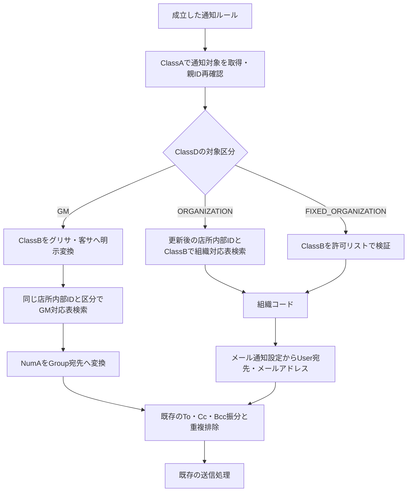

# 通知対象区分と設定手順

更新日：2026/11/10

通知対象のClassB「対象グループ」を共用し、ClassD「対象区分」で保存値の意味を切り替える。固定組織専用項目は追加しない。

## 通知対象（サイト843620）

| 物理項目 | 用途 |
| --- | --- |
| ClassA | 親通知ルールのResultId。既存どおりリンクの内部値 |
| ClassB | 対象グループ。区分に応じた下記の保存値 |
| ClassC | To / Cc / Bcc。既存仕様を維持 |
| ClassD | 新設する対象区分。必須・単一選択 |

| ClassDの表示名 | ClassD保存値 | ClassBの例・保存値 |
| --- | --- | --- |
| 店所連動組織 | ORGANIZATION | 既存のグリッドサービスG、お客さまサービスグループ等 |
| 店所連動GM | GM | グリサGM、客サGM |
| 固定組織 | FIXED_ORGANIZATION | 実際の組織コード |

ClassBの選択肢にGMと固定組織を追加する。GMは表示・保存とも「グリサGM」「客サGM」。固定組織は表示名を組織名、保存値を組織コードとする。環境固有の組織ID・組織マスターのレコードIDを保存しない。

ClassDが空欄・未知、ClassBが空欄の場合は設定エラー。既知のGM値・固定組織コードを別区分で指定した場合もエラーとする。通常の組織グループは既存マスターを利用し、許可するグループ一覧の新設はしない。通常組織の未登録グループで取得0件となる動作は維持する。

## 店所・GM対応表（サイト727689）

利用者確認済みの割り当て。

| 物理項目 | 用途 |
| --- | --- |
| ClassA | 店所マスター参照の内部レコードID |
| ClassC | グループ区分。保存値は「グリサ」「客サ」 |
| NumA | PleasanterのGroupId。正のInt32整数 |
| DescriptionA | GMグループコード。「GM」＋対応する組織コード |
| ClassD | GMグループ名。表示・デバッグ用 |

通知対象ClassB「グリサGM」→ClassC「グリサ」、「客サGM」→ClassC「客サ」と明示的に対応させる。対応はNOTIFICATION_GM_CATEGORIESで定義する。略称からの部分一致やグループ名の推測は行わない。

通常店所は客サの対応行が1件、特殊店所は同じ店所・区分「客サ」の対応行を第一〜第三それぞれ1件ずつ登録する。各行は異なる組織コードから作ったGMコードと、対応するGroupIdを持つ。枝番は付けない。GMグループ名は検索キーにしない。

検索はClassAとClassCの両方をJSON配列文字列＋ExactMatchMultipleで指定し、取得後も両項目を完全一致で再確認する。同じ店所・区分に該当する全行を利用するため、第一〜第三の名称展開は不要。現在のGM選択肢は「グリサGM」「客サGM」の2種類で、第一GMなどの直接指定は未対応。店所未設定・対応行なし・NumA不正・GMコードの空欄／不正は設定エラー。

DescriptionAはGMプレフィックスと空白・宛先区切り等の混入を検証する。対応する組織コードとの内容一致はマスター登録時に管理する。通知時に組織対応表を参照してコードを生成・補正することはしない。

## 固定組織の許可リスト

FIXED_ORGANIZATION_CODESに許可する組織コードを文字列で登録し、同じ保存値をClassBの選択肢に設定する。先頭ゼロ・大文字小文字は保持する。

利用者指定の許可コードは文字列の`1014797`・`1015247`・`1015246`・`TTA`。これら以外は設定エラーとする。通知対象ClassBにはコードを保存し、表示名には対応する実際の組織名を設定する。

固定組織は更新対象の店所コードを参照せず、ClassBの組織コードでメール通知設定のDescriptionBを検索する。通知先のClassZ（ユーザー）とDescriptionA（メールアドレス）は既存処理を利用する。

## 取得フロー

店所連動組織の客サ親・第一・第二・第三の検索展開は従来どおり。GMはメール通知設定を経由しない。固定組織は店所・組織対応表とGM対応表を経由しない。

## Group宛先・重複排除の範囲

NumA=12345なら宛先は`[Group12345]`。通知エンジンはグループのメンバーを独自展開せず、Pleasanter標準に委ねる。

- 同じGroupIdを複数行から取得した場合は重複排除する。
- To→Cc→Bccの優先で、同じ宛先文字列を既存どおり排除する。
- `[User1]`と、そのユーザーを含む`[Group12345]`は異なる文字列なので、スクリプトでは重複判定できない。
- Pleasanter 1.4.23.3は同じ宛先欄の展開後メールアドレスを重複排除する。一方、ToとCcとBccをまたぐメンバー重複は残ることを専用環境で確認した。人物単位のTo優先制御や重複配送防止は保証しない。
- 空・無効グループは有効な通知先へ展開されない。実在する有効なGroupId・メンバー・ユーザーの登録メールはマスター運用時に確認する。スクリプトのTo必須判定は展開前の宛先文字列に対して行う既存仕様のまま。
- Sendの戻り値・成功ログは実メール配送や全メンバーへの到達を保証しない。

公式資料：[通知のGroup宛先](https://pleasanter.org/en/manual/managers-guide/manage-table/notifications/table-management-notification-routing/#specifying-an-id-directly-in-the-address)、[1.4.23.3のAddresses.cs](https://github.com/Implem/Implem.Pleasanter/blob/Pleasanter_1.4.23.3/Implem.Pleasanter/Libraries/Mails/Addresses.cs)。

## 導入手順

1. 通知対象のClassDが未使用か確認し、対象区分として追加する。別用途で使用中なら適用を止め、物理項目を調整する。
2. 既存通知対象レコードのClassDをORGANIZATIONで補完する。ClassB・ClassC・親ルールのリンクは変更しない。
3. ClassBにGMの選択肢を追加する。固定組織が決まった場合はコードの許可リストとClassBの選択肢を両方更新する。
4. GM対応表の店所内部ID・ClassCの保存値・NumA・GMコードを確認する。
5. 新コードを登録し、NOTIFICATION_SEND_MODE="TEST"のまま成立ルールの宛先と件数を確認する。既存組織・通常GM・特殊店所GM・固定組織を対象に確認する。
6. 内容確認後にNOTIFICATION_SEND_MODEをPRODUCTIONへ切り替える。NOTIFICATION_DEBUGは送信可否とは独立。

既存レコード補完とコード切替は同じ保守作業で実施する。新コードは未設定の区分をORGANIZATIONと推測しない。ロールバックは旧コードへ戻せば既存組織通知の経路を利用できるが、新GM・固定組織の通知対象行は無効化／除外してから戻す。

## 影響範囲・テスト

変更箇所はサイト・項目・区分設定、getNotificationTargets、getTargetRecipientAddresses、新規getGmGroupAddresses。通知条件・演算子・AND/OR・評価回数／順序・更新前SS・メール送信処理は変更しない。

自動テストは通常／特殊店所、他店所・類似区分除外、NumA・GMコード異常、GroupId重複、固定組織の店所非依存・許可リスト、区分取り違え、3区分混在とTo/Cc/Bccを確認する。既存組織は移行後のClassDを設定した入力で変更前とAPI呼び出し・条件評価・送信内容・例外を比較する。[実環境検証結果](TARGET-TYPES-VALIDATION.md)も参照。
