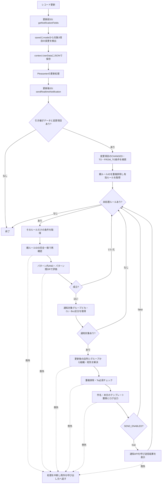
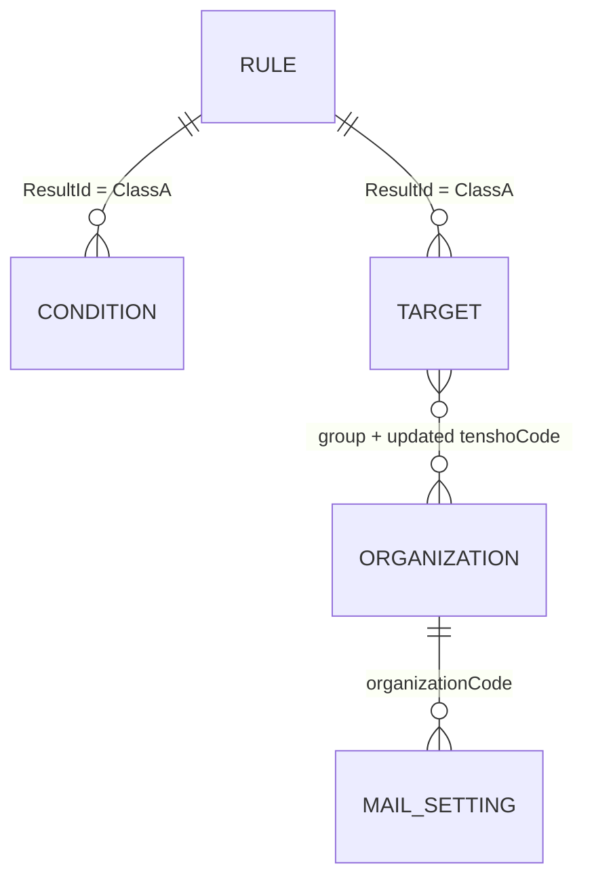
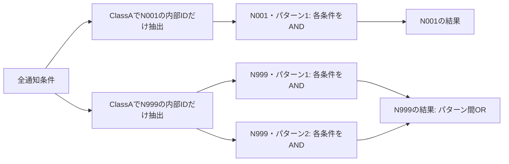

# 通知エンジン設計書・仕様書

更新日：2026/11/06
対象：`notification/sk-realtime-notification.js`、通知ID混在修正後＋IN / NOT_IN追加版

## 1. 目的と対象範囲

レコード更新時の変更を起点に、テーブルで定義した条件を通知ルール単位で評価し、更新後の店所に対応する組織・宛先へメールを通知する。

本書は現行実装の仕様を記載する。今後の改善案と未解決点は現行仕様と区別する。現在は `SEND_ENABLED = false` のため、宛先と件名・本文の生成、ログ出力までを行い、送信APIは呼び出さない。

対象バージョンはPleasanter 1.4.23.3。Dockerで確認した構成はPostgreSQL 16。実メール配送と利用先の権限設定は検証範囲外。

## 2. 実行単位と登録

本体ファイルは関数定義のみで、自動では実行しない。更新前SSでファイル本体を読み込んで `getNotificationFields()` を呼び出し、更新後SSでファイル本体を読み込んで `sendRealtimeNotification()` を呼び出す。元環境の登録方式と照合して適用する。

- 更新前：`saved` と `model` を比較し、変更情報を作成する。
- 引き継ぎ：`context.UserData.notificationData` にJSON文字列を保存する。
- 更新後：変更情報を取得し、ルールを順に評価する。
- 通知処理：成立したルールごとに宛先・件名・本文を生成する。

`context.UserData` はこの更新前後の処理で使用する。永続的な通知履歴や再送キューとしては扱わない。

## 3. 全体フロー



例外捕捉はルール単位にも全体にもない。上図以外のJSON解析・検索でも例外が発生すれば中断する。送信APIがfalseを返す場合は例外とは別で、失敗メッセージを表示し次のルールへ進む。

## 4. 対象レコードと変更情報

| 論理項目名 | 変更検出・条件判定の物理項目 | 用途 |
| --- | --- | --- |
| status | ClassB | ステータス |
| tenshoCode | ClassD | 店所コード |
| denatsu | ClassE | 電圧 |

比較時は `String(value ?? "")` とし、nullとundefinedを空文字として扱う。異なる場合だけchangedFieldsに格納する。格納するoldValue / newValue自体は元の値であり、この時点では文字列化しない。

```json
{
  "changedFields": {
    "status": { "oldValue": "0000", "newValue": "0100" },
    "denatsu": { "oldValue": "", "newValue": "60kV" }
  }
}
```

メール本文の `{電圧}` はClassFを参照する。ClassEとの相違は原本から保持している現行仕様であり、意図した業務項目かは別途確認が必要。今回の条件混在修正では変更していない。

## 5. データモデルと項目対応



図は論理的な対応であり、DBの外部キー制約を表さない。グループ・組織の対応も実行時に検索する。

| テーブル | サイトID | 使用する項目 |
| --- | --- | --- |
| 通知ルール | 843610 | ResultId：内部の親ID、Title：表示用通知ID（例N001）、DescriptionA：通知名、CheckA：有効、DescriptionB：件名、DescriptionC：本文 |
| 通知条件 | 843614 | ClassA：親ルールのResultId、ClassB：条件パターン、ClassC：論理項目名、ClassD：演算子、DescriptionB：比較値 |
| 通知対象 | 843620 | ClassA：親ルールのResultId、ClassB：グループ、ClassC：To / Cc / Bcc |
| 組織 | 846822 | ClassA：店所コード、ClassC：グループ、DescriptionA：組織コード |
| メール通知設定 | 809267 | DescriptionB：組織コード、ClassZ：ユーザIDのJSON配列、DescriptionA：直接メールアドレス |

**表示用通知IDのN001ではなく、内部のResultIdで親子を関連付ける。** 例えばN001のResultIdが846996なら条件のClassAは846996となる。店所もマスター参照の分類なら、表示001と保存されたレコードIDを区別し、対象レコードのClassDと組織表のClassAの内部値をそのまま照合する。

現コードではSITE_IDS.conditions / rulesは参照されていない。通知条件検索は843614を直接指定し、ルールは条件のClassAから `items.Get(Number(ruleId))` で取得する。環境移行時は定数だけ変更して完了と判断しない。

## 6. ルール・条件の選択

1. 変更された論理項目名をClassCで検索する。
2. CHANGED / TO / FROM_TOの条件だけを候補抽出の起点とする。
3. ClassAからルールIDを重複排除して取得する。
4. ルールのCheckAが真偽値trueの場合のみ評価する。数値1や文字列trueは有効としない。
5. 各ルールについて条件を取得する。検索値は `JSON.stringify([String(ruleId)])`、検索方法はExactMatchMultipleとする。
6. 検索結果を `String(condition.ClassA) === String(ruleId)` で再確認する。
7. **親IDを確認済みの条件だけ**をevaluateConditionsへ渡す。

検索の絞り込みだけを正しさの根拠にしない。余分な条件が返っても、他ルールの条件を評価に入れないことを不変条件とする。

## 7. 演算子

| 演算子 | 判定元 | 成立条件 |
| --- | --- | --- |
| CHANGED | changedFields | 対象項目の変更情報が存在する |
| TO | change.newValue | 変更情報が存在し、変更後が比較値に一致する |
| FROM_TO | change.oldValue / newValue | 変更情報が存在し、前後が指定した2値に一致し、その2値が異なる |
| EQ | model | 現在値と比較値が等しい |
| NE | model | 現在値と比較値が異なる |
| IN | model | 現在値がカンマ区切りの比較値のいずれかに完全一致する |
| NOT_IN | model | 現在値がカンマ区切りの比較値のどれにも一致しない |
| GE | model | 両方が空文字以外・有限数に変換可能で、現在値が比較値以上 |
| LE | model | 両方が空文字以外・有限数に変換可能で、現在値が比較値以下 |

TO / EQ / NEの比較値に自動の空白除去は行わない。IN / NOT_INも比較値の各要素だけtrimする。文字列比較で数値変換は行わない。GE / LEの空欄判定は空文字との比較で、空白だけの値をtrimして拒否する実装ではない。例えば空白だけの文字列はNumberで0になり得る。これも現行仕様として区別する。

FROM_TOは半角カンマで2要素に分け、各要素だけtrimする。両側は空でないことを必須とし、先頭ゼロを維持する。レコード側はtrimしない。`0100,0200` と `100,200` は異なる。比較値が不正なら設定例外とする。

IN / NOT_INは比較値が2要素以上・全要素が空でないことを必須とし、空欄・単一値・空要素は設定例外にする。対象値が空文字、null、undefinedならINは不成立、NOT_INは成立する。比較値は文字列で完全一致し、対象値はtrimしない。重複した要素は禁止しない。IN / NOT_INは通知候補抽出のトリガーではない。

未定義項目・未定義演算子は例外。ただしFROM_TO / IN / NOT_IN以外の条件はAND/ORの短絡評価で未評価となる場合があり、全設定の一括検証機能ではない。

## 8. 条件パターンと通知IDの境界

パターンの識別単位は **親ルールIDとパターン番号の組合せ**。取得段階で親ルールIDを分離した後、ルール内のパターン番号で分類する。ClassBが空などのfalsy値なら文字列1として扱う。



条件0件は不成立。同じパターン内の条件はすべて成立する必要があり、いずれかのパターンが成立すればそのルールが成立する。

候補抽出にはCHANGED / TO / FROM_TOが必要だが、各パターンにトリガーが必須という追加制約はない。候補になったルールの別パターンがEQなどだけで成立する場合もある。

FROM_TO / IN / NOT_INについては、候補ルールに所属する比較値を先に形式検証する。AND/ORの短絡評価で不正な比較値が隠れないようにする。他ルールの条件はここに渡さない。

## 9. 条件設定の具体例

| 通知ID | パターン | 項目 | 演算子 | 比較値 |
| --- | --- | --- | --- | --- |
| N001 | 1 | status | FROM_TO | 0000,0100 |
| N001 | 1 | denatsu | NE | 6kV |
| N001 | 1 | denatsu | NE | 20kV |
| N999 | 1 | status | TO | 0220 |
| N999 | 1 | denatsu | EQ | 6kV |
| N999 | 2 | status | TO | 0300 |

入力が0000→0100、電圧60kVならN001は成立、N999は不成立。両方のパターン番号が1でも、N999の条件がN001に加わることはない。

## 10. 宛先・本文・送信

- 通知対象0件はログを出してそのルールをスキップする。
- 更新後のClassDと対象グループから組織コードを取得する。変更前の店所には通知しない。通知対象のClassAと組織のClassA / ClassCはJSON配列文字列＋ExactMatchMultipleで検索し、取得後の一致確認も行う。組織未取得時は取得・条件一致・コード有無の件数を記録する。
- 宛先区分はTo / Cc / Bccの完全一致のみ許可する。
- ClassZはJSON配列とし、trim後に数字だけのユーザIDを採用する。不正IDは除外し、配列以外・壊れたJSONは例外となる。
- ユーザIDは `[User12345]` 形式に変換する。
- 直接アドレスはカンマ・セミコロン・改行で分割し、空白除去後に簡易形式チェックする。
- To→Cc→Bccの順で、大文字小文字を区別せず同じ文字列を排除する。
- ユーザ指定と直接アドレスの同一人物判定、ルール間の重複排除は行わない。
- Toが空なら例外。Cc / Bccだけでの送信は許可しない。

| プレースホルダー | 値 |
| --- | --- |
| 件名 | model.Title |
| 店所コード | 更新後のmodel.ClassD |
| ステータス | model.ClassB |
| 電圧 | model.ClassF |

件名と本文は通知ルールのDescriptionB / Cを使う。未知のプレースホルダーは例外。送信有効時はType=1、Address / CcAddress / BccAddress、Title、Bodyを設定する。Sendがtrueなら成功、falseなら失敗のメッセージを出す。

複数のルールが成立すれば各ルールで処理し、送信有効なら複数通になり得る。再実行時の二重送信防止・再送機能・キューは実装していない。

## 11. 障害時の扱いと運用確認

| 状況 | 現行の挙動 |
| --- | --- |
| 引き継ぎデータなし・変更なし | 終了 |
| 有効ルールなし・条件不成立 | 通知処理を行わない |
| 通知対象なし | そのルールをスキップ |
| 不正な設定・Toなし・検索等の例外 | 処理を中断、後続ルールも実行しない |
| Sendがfalse | 失敗ログ・画面メッセージを出して次のルールへ進む |
| SEND_ENABLED=false | 送信内容をログ出力し、送信APIを呼ばない |

更新後通知が失敗してもレコードの更新が戻るとは限らない。1.5.4.0の検証ではAPIが422でも更新値が保存された。1.4.23.3の設定例外はHTTP 500を返した。利用側はエラー表示だけで更新未保存と判断せず、保存値を確認する。

導入時は、サイトID・実行条件・呼び出し・項目対応・選択肢の内部値・親ID・権限を確認する。ログには宛先と本文も出るため、利用環境のログ保管・閲覧範囲を確認する。変更する場合は別の仕様変更として扱う。

## 12. 追跡先

- [検証方針・必須ケース](TESTING.md)
- [条件混在の原因分析と再発防止](INCIDENT-20261105.md)
- [混在修正時の実測結果](../RULE-SCOPE-VALIDATION.md)
- [FROM_TO追加時の結果](../FROM_TO-VALIDATION.md)

## 13. ログ表示

通知候補を表示用通知IDの一覧で示し、各ルールの条件取得・判定・宛先処理を空行なしの区切り線でまとめる。条件一覧には区切り文字を付け、条件評価のJSONは維持する。実際に評価していない条件のJSONは出さない。正常終了時だけ終了行を出し、例外時に完了したように表示しない。詳細と例は[ログ表示](../LOGGING.md)を参照。
